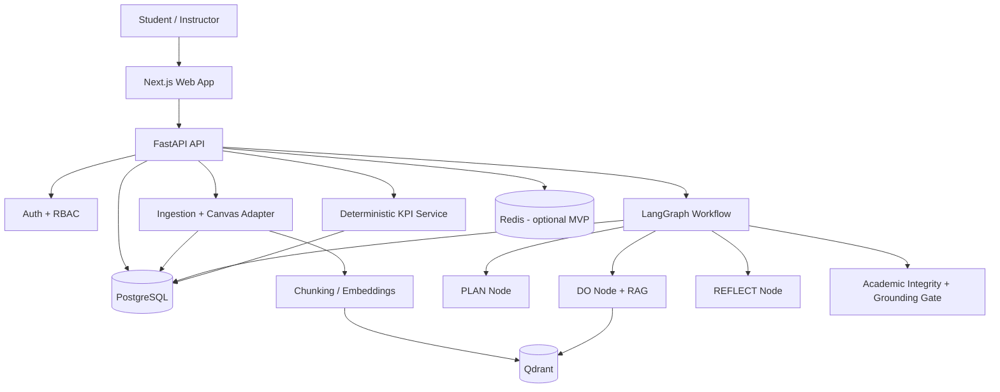

# AI Learning Companion — Tự học tiếng Anh theo Plan–Do–Reflect

Ứng dụng giúp một người học đặt mục tiêu tiếng Anh, lập lịch theo quỹ thời gian,
tự luyện và nhìn lại tiến độ mỗi tuần. Giao diện Next.js dùng FastAPI và hỗ trợ
đăng nhập demo với học phần `english101`. Backend dùng Gemini Developer API với
model mặc định `gemini-3.5-flash-lite`. [Cấu hình Gemini](backend/README.md#gemini-và-free-tier)

## 1. Tổng quan

1. **PLAN.** Nhập mục tiêu, trình độ CEFR nếu muốn, kỹ năng ưu tiên và số phút
   rảnh mỗi ngày. Xem, sửa và duyệt từng nhiệm vụ có thời lượng dự kiến.
2. **DO.** Cập nhật trạng thái nhiệm vụ, yêu cầu bài luyện để tự làm hoặc xin gợi
   ý sửa bài nháp. Phản hồi dựa trên học liệu có nguồn và báo rõ khi thiếu căn cứ.
   Trợ lý hướng dẫn người học tự làm bài tính điểm.
3. **REFLECT.** Xem nhiệm vụ đã tự đánh dấu, ghi lại kỹ năng đã luyện, khó khăn và
   thời gian tuần sau. Người học xác nhận ghi chú muốn dùng cho kế hoạch tiếp theo.

Chạy test và build theo hướng dẫn backend. Chế độ demo có dữ liệu học liệu tổng
hợp. Nhiệm vụ hiển thị trong phiên đang mở và số phút trên giao diện là thời lượng
dự kiến. [Chạy và kiểm thử](backend/README.md) · [Đánh giá offline](eval/README.md) · [Kiến trúc hiện tại](docs/MULTI_AGENT.md)

Các mục từ phần 2 lưu thiết kế MVP ban đầu để tham chiếu khi đọc kiến trúc và
lộ trình.

### Người dùng

- **Người học:** quản lý mục tiêu tiếng Anh, nhiệm vụ, lịch học, tiến độ và phản tư.
- **Giảng viên:** xem thông tin tiến độ tổng hợp theo lớp/môn; xem xét các cảnh báo cần can thiệp theo chính sách phân quyền.

### Giá trị khác biệt

- Không chỉ tạo to-do list: kế hoạch được cập nhật từ tiến độ thực tế và kết quả Reflect.
- Hỗ trợ học thuật có **trích dẫn đến đúng tài liệu học phần**, đồng thời nêu rõ khi thiếu căn cứ.
- Kết quả học tập, hạn nộp và KPI được tính bằng **code xác định** thay vì để LLM tự suy diễn số liệu.
- Đặt **liêm chính học thuật, quyền riêng tư và human-in-the-loop (HITL)** làm ràng buộc thiết kế.

## 2. Phạm vi MVP (cá nhân, dự kiến 6–8 tuần)

| Mã | Tính năng MVP | Tiêu chí hoàn thành |
|---|---|---|
| M1 | Đăng nhập 2 vai trò | Student/Instructor, endpoint có kiểm tra phân quyền |
| M2 | Nhập học phần và assignment | CSV/JSON hoặc nhập thủ công, PDF syllabus có kiểm tra kết quả trích xuất |
| M3 | PLAN | Sinh kế hoạch tuần theo deadline, quỹ thời gian và ưu tiên; người học duyệt/sửa |
| M4 | DO | Theo dõi trạng thái task và luyện theo học liệu có trích nguồn |
| M5 | REFLECT | Phiên phản tư cuối tuần, người học xác nhận nội dung trước khi lưu memory |
| M6 | Dashboard | Tiến độ tổng hợp, tỷ lệ nộp đúng hạn tính bằng code; không tiết lộ dữ liệu cá nhân |
| M7 | Safety + Evaluation | Bộ test chống làm hộ, test grounding, permission tests, KPI và log chi phí/độ trễ |

**Chiến lược cá nhân:** ưu tiên một luồng chạy được trước; chia công việc thành các chặng nhỏ, mỗi chặng có test và commit. Vai trò giảng viên trong MVP có thể dùng tài khoản demo cùng dữ liệu tổng hợp giả lập.

**Chưa thuộc MVP:** Canvas LTI 1.3 tích hợp thật, gửi push/email tự động, dự đoán rủi ro bằng ML, multi-agent độc lập quy mô lớn, load test 1.000 người dùng đồng thời trên production. Những mục này là hướng mở rộng cần kiểm chứng.

## 3. User flow chính

Một người học tự đánh giá trình độ A2, muốn hỏi và chỉ đường trong hội thoại ngắn.
Họ nhập 20 phút rảnh thứ Hai và 15 phút thứ Năm. Sau khi duyệt các nhiệm vụ dự
kiến, họ luyện đổi vai theo học liệu, xin gợi ý cho một câu chỉ đường đã viết và
đánh dấu những nhiệm vụ đã hoàn thành. Cuối tuần, họ ghi lại điểm còn vướng và cân
nhắc chia 20 phút tuần sau thành hai lượt luyện nói ngắn.

## 4. Kiến trúc đề xuất



**Nguyên tắc:** Plan, Do và Reflect là **node trong một workflow có state chung** ở MVP; không nhất thiết phải là ba agent chạy tự trị. Hành động có tác động (đổi deadline, lưu mục tiêu, gửi nhắc việc) cần được xác nhận và kiểm tra quyền.

### Tech stack

| Thành phần | Công nghệ dự kiến |
|---|---|
| Frontend | Next.js, React, TypeScript |
| Backend | Python, FastAPI, Pydantic |
| Workflow | LangGraph |
| LLM | Model nhỏ cho tác vụ thường, routing theo nhu cầu |
| RAG | Qdrant, embedding model, reranker (giai đoạn nâng cao) |
| Database | PostgreSQL |
| Cache/queue | Redis (sau khi xác định điểm nghẽn) |
| Ingestion | PDF parser, CSV/JSON, Canvas REST adapter tùy chọn |
| Deploy | Docker Compose cho demo; cloud là phần triển khai tiếp |
| Test/Eval | pytest, bộ tình huống gắn nhãn, RAG evaluation, load testing |

## 5. Mô hình dữ liệu mức khái niệm

- `users(id, role, pseudonym, created_at)`
- `courses(id, code, title, instructor_id)`
- `enrollments(user_id, course_id)`
- `learning_resources(id, course_id, title, version, source_uri, checksum, uploaded_at)`
- `assignments(id, course_id, title, due_at_utc, source_resource_id)`
- `submissions(id, assignment_id, user_id, submitted_at_utc, status, verified_source)`
- `weekly_goals(id, user_id, week_start, goal_text, available_minutes, status)`
- `study_tasks(id, user_id, assignment_id, goal_id, title, estimated_minutes, due_at_utc, status)`
- `reflections(id, user_id, week_start, answers_json, user_approved_at)`
- `competency_states(id, user_id, course_id, skill_key, self_rating, evidence_ref, updated_at)`
- `audit_logs(id, actor_id, action, resource_type, resource_id, timestamp)`

Dữ liệu cá nhân và nội dung phản tư không được đưa vào dashboard tổng hợp nếu không có chính sách rõ ràng. Thiết lập giới hạn kích thước nhóm trước khi công bố số liệu để tránh nhận diện gián tiếp.

## 6. Nguồn dữ liệu

### MVP

- Syllabus PDF do người triển khai chuẩn bị hoặc được phép sử dụng.
- Assignment CSV/JSON giả lập có timestamp và trạng thái thực hiện.
- Tài liệu môn học được phép tải lên, có metadata: môn, phiên bản, trang, checksum.

### Mở rộng

- **Canvas REST API:** lấy course/assignment/submission theo quyền được cấp; cần cơ chế đồng bộ, xử lý timezone, phân trang, rate limit.
- **LTI 1.3:** cần đăng ký tích hợp/ủy quyền tại đơn vị vận hành Canvas; không giả định API key/LTI access đã có.
- **OULAD, EdNet, ASSISTments:** dùng nghiên cứu phân tích hành vi/năng lực; **không tương đương** dữ liệu deadline/submission của Canvas. Phải lập bảng ánh xạ schema, license và giới hạn đánh giá.

## 7. RAG có nguồn và quản lý phiên bản

Pipeline: `Upload → parse → validate metadata → chunk theo cấu trúc → embed → index → retrieve → (rerank) → cite → answer`.

Mỗi chunk phải mang `course_id`, `resource_id`, `document_version`, `page/section`, `source_uri`. Truy xuất phải lọc theo **quyền của người hỏi** và môn học. Nếu không có bằng chứng hỗ trợ, AI từ chối khẳng định thay vì tạo trích dẫn giả. Khi tài liệu được cập nhật, đánh dấu phiên bản cũ và cập nhật index có kiểm soát.

## 8. Quy tắc AI và an toàn

1. **Không làm hộ bài tính điểm:** không tạo bài nộp hoàn chỉnh hoặc lời giải cuối cùng cho assignment đang được chấm. Có thể giải thích khái niệm, hướng dẫn cách suy nghĩ, đặt câu hỏi gợi mở, dùng ví dụ tương tự và nhận xét bài nháp của người học theo chính sách môn học.
2. **Grounded answers:** với khẳng định về học liệu phải chỉ rõ tài liệu và vị trí; nếu không đủ bằng chứng thì nêu giới hạn.
3. **RBAC/RLS:** sinh viên chỉ đọc dữ liệu được cấp phép; giảng viên chỉ xem lớp phụ trách và thông tin cần thiết.
4. **Privacy:** dữ liệu phản tư là nhạy cảm theo ngữ cảnh, cần hạn chế quyền, giữ tối thiểu, có thời hạn lưu và chức năng xóa/xuất nếu áp dụng.
5. **HITL:** người học duyệt kế hoạch và memory; giảng viên xác minh cảnh báo trước khi hành động, không coi dự báo là kết luận về cá nhân.
6. **Prompt injection:** coi nội dung tài liệu và tin nhắn tải lên là dữ liệu không đáng tin; không cho phép thay đổi policy, gọi tool hoặc vượt quyền.
7. **Determinism:** tính toán số nộp bài, ngày hạn, tỷ lệ đúng hạn, chi phí và thời gian bằng code, có phép thử đối chiếu.

## 9. KPI & cách đánh giá

### KPI sản phẩm

- **Tỷ lệ nộp đúng hạn** = số assignment có `submitted_at <= due_at` / số assignment đến hạn hợp lệ trong kỳ. Chỉ tính khi có dữ liệu submission đáng tin cậy; phân biệt chưa nộp và chưa có dữ liệu.
- **Task completion rate** = task đã hoàn thành / task đã đến hạn trong kỳ.
- **Plan adherence** = task hoàn thành đúng mốc kế hoạch / task được lên lịch (cần thống nhất quy tắc reschedule).
- **Reflection completion** = tuần có Reflect được người học xác nhận / tuần đủ điều kiện đo.

Không tuyên bố “cải thiện trước/sau” chỉ nhờ dữ liệu giả lập. Để đánh giá tác động, cần theo dõi nhóm người dùng qua thời gian, có baseline thích hợp, xem xét yếu tố gây nhiễu và báo cáo kích thước mẫu.

### KPI AI / hệ thống

- Citation support rate / groundedness trên bộ câu hỏi có đáp án và nguồn chuẩn.
- Academic-integrity compliance trên tình huống thường, tình huống biên, yêu cầu làm hộ và jailbreak.
- Permission leakage rate = 0 trong bộ test truy cập chéo.
- Latency p50/p95; tokens/request; chi phí/request, cache-hit rate (nếu dùng cache).
- Load test tăng dần; **1.000 concurrent users là mục tiêu nâng cao chưa được xác nhận**.

## 10. Cấu trúc repository đề xuất

```text
ai-learning-companion/
├── README.md
├── GUIDE.md
├── .env.example
├── docker-compose.yml
├── backend/
│   ├── app/
│   │   ├── api/
│   │   ├── auth/
│   │   ├── agents/          # plan, do, reflect + shared state
│   │   ├── rag/
│   │   ├── services/        # deadlines, submissions, KPI
│   │   ├── models/
│   │   └── main.py
│   ├── tests/
│   └── requirements.txt
├── frontend/
│   ├── app/
│   └── package.json
├── data/
│   └── samples/             # chỉ dữ liệu tổng hợp/được phép
├── eval/
│   ├── fixtures/
│   └── reports/
└── docs/
    ├── architecture.md
    ├── data-contracts.md
    └── threat-model.md
```

> Cấu trúc trên là **đề xuất**; các đường dẫn chỉ sử dụng được sau khi người phát triển khởi tạo code tương ứng.

## 11. Chạy dự án (sau khi có code)

Các lệnh dưới đây là **quy ước triển khai dự kiến**, không phải cam kết repository hiện đã chạy được:

```bash
# 1. Clone repository cá nhân
# git clone <REPOSITORY_URL>
# cd ai-learning-companion

# 2. Tạo cấu hình từ ví dụ nếu chưa có
test -e .env || cp .env.example .env

# 3. Điền các biến môi trường được cấp (không commit .env)
# 4. Sau khi cấu hình Docker Compose hoàn chỉnh:
docker compose up --build

# 5. Sau khi backend có health endpoint:
# http://localhost:8000/health
# http://localhost:3000
```

Cấu hình backend hiện tại gồm `DATABASE_URL`, `QDRANT_URL`, `GEMINI_API_KEY`,
`GEMINI_MODEL`, `JWT_SECRET` và `APP_ENV`. Giữ key thật trong cấu hình local.

## 12. Definition of Done (MVP)

- [ ] Có thể demo một user flow từ nhập assignment → Plan → Do → Reflect → điều chỉnh tuần sau.
- [ ] Có đăng nhập, phân quyền sinh viên/giảng viên và unit/integration tests cơ bản.
- [ ] RAG cung cấp nguồn đúng, có xử lý không tìm được bằng chứng.
- [ ] Guardrails chống làm hộ và kiểm tra đầu vào tài liệu không đáng tin.
- [ ] Dashboard không lộ thông tin người học; KPI tính từ dữ liệu có thể kiểm toán.
- [ ] Có ít nhất 5 test case end-to-end kèm đầu vào, kết quả thực tế và kỳ vọng.
- [ ] Có tài liệu setup, video demo và báo cáo hạn chế chưa triển khai.

## 13. Tài liệu liên quan

Xem [trạng thái đã kiểm chứng](docs/PROJECT_STATUS.md), [kiến trúc hiện tại](docs/ARCHITECTURE.md) và [roadmap ba Agent](docs/TASKS.md) để tiếp tục phát triển.

Xem [`GUIDE.md`](./GUIDE.md) để biết lộ trình thực hiện cá nhân, mốc nghiệm thu theo giai đoạn và bộ test gợi ý.

## 14. Tuyên bố phạm vi & đạo đức

Sản phẩm là công cụ **hỗ trợ người học tự chủ**, không thay thế giảng viên hoặc hệ thống chấm điểm. Việc triển khai trên dữ liệu sinh viên thực phải tuân thủ chính sách đơn vị đào tạo, quy định bảo vệ dữ liệu áp dụng và nguyên tắc tương tự FERPA; **không mặc nhiên khẳng định tuân thủ FERPA** chỉ nhờ ẩn danh.
