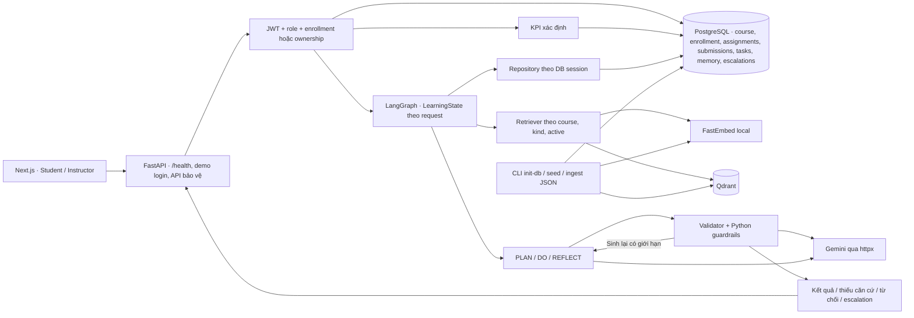

# Kiến trúc và API hiện tại

Ngày đối chiếu mã nguồn 24/11/2026. [MULTI_AGENT.md](MULTI_AGENT.md) giữ đặc tả API, state, guardrails, KPI và cấu hình workflow. [README.md](../README.md) và [GUIDE.md](../GUIDE.md) lưu mục tiêu sản phẩm cùng thiết kế MVP ban đầu. Contract đang chạy lấy từ [router FastAPI](../backend/app/api.py) và [Pydantic schemas](../backend/app/contracts.py).

## Phụ thuộc ở runtime

Giao diện gọi API trực tiếp từ trình duyệt, thông qua [client TypeScript](../frontend/app/api.ts). Giao diện giữ session token trong localStorage và danh sách task trong React state. Auth lấy danh tính từ JWT, sau đó đối chiếu DB. Workflow khởi tạo theo request và truy xuất học liệu cho cả ba mode trước khi sinh nội dung. Task đã duyệt và memory được ghi vào DB qua các thao tác riêng. Memory đã xác nhận được đọc lại theo người học, học phần và các tuần trước để phục vụ PLAN.

## Ranh giới contract

- Bề mặt hiện tại gồm health, demo login, workflow, tạo/cập nhật task, duyệt/thu hồi memory, danh sách escalation và KPI giảng viên. Xem [bảng method, đường dẫn và quyền](MULTI_AGENT.md#api).
- PLAN nhận quỹ phút nguyên theo ngày, trả đề xuất và citation. Frontend lưu từng task qua POST riêng. Task tạo mới trả `201`. PATCH và PUT kiểm tra chủ sở hữu. Workflow chỉ chuyển `unavailable` thành HTTP `503`; các trạng thái nghiệp vụ còn lại có body workflow và HTTP `200`. Lỗi DB có thể trả `503` với `detail`.
- `Chunk` giữ ID, course, resource, version, title, URI, page, kind và text. Phân quyền diễn ra trước retrieval. Mã dựng citation từ metadata và kiểm tra quote. Validator ngữ nghĩa dùng Gemini. [Cấu trúc dữ liệu](../backend/app/contracts.py) · [Retrieval](../backend/app/retrieval.py)
- PostgreSQL và Qdrant nằm trong [Compose](../docker-compose.yml). Uvicorn, Next và CLI chạy riêng theo [hướng dẫn local](../backend/README.md). `init-db` dùng `create_all` để khởi tạo bảng, kế hoạch migration thuộc các thay đổi schema sau này.
- Đề xuất đọc danh sách task, import assignment và vòng đời phiên bản học liệu nằm trong [TASKS.md](TASKS.md). Mọi contract mới cần được duyệt trước khi client và server triển khai.
