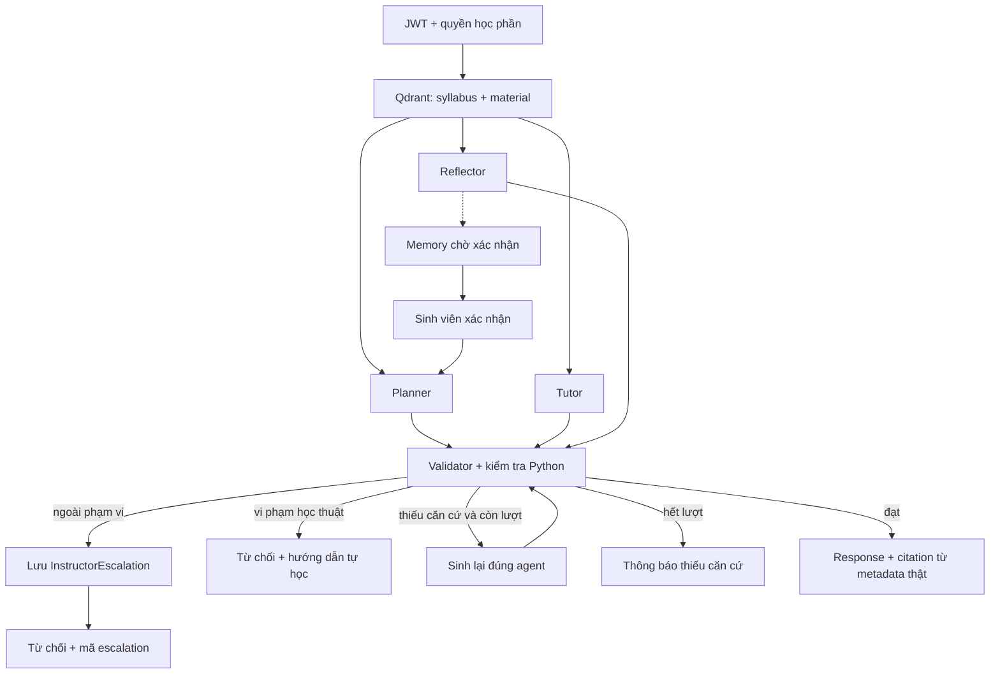

# Multi-Agent backend: Plan–Do–Reflect

Phần triển khai ở `backend/app/`; không cần dịch vụ AI trả phí hoặc API key embedding.
Frontend có luồng tiếng Anh và dashboard giảng viên dùng đăng nhập demo.

## Sơ đồ và trách nhiệm



`LearningState` giữ `request`, định danh người học/môn, `chunks`, assignments,
approved memory, `draft_response`, verdict, feedback, attempts và kết quả cuối.
Graph mới được tạo cho mỗi request với repository theo session; không dùng global
conversation state, không chia sẻ memory giữa các sinh viên. Một client Gemini
và retriever được quản lý trong lifespan. Chỉ trả kết quả cuối, không stream draft.

| Module                           | Trách nhiệm                                                                            |
| -------------------------------- | ---------------------------------------------------------------------------------------- |
| `prompts.py`                   | System prompt riêng cho Planner, Tutor, Reflector, Validator                            |
| `contracts.py`                 | Pydantic schema, strict boolean, dữ liệu citation và lịch                            |
| `llm.py`                       | Gemini REST qua `httpx`, `GEMINI_API_KEY`, structured output và validation Pydantic |
| `retrieval.py`                 | FastEmbed local, Qdrant filter course/kind/active, ingest JSON                           |
| `guardrails.py`                | Kiểm tra quote, nguồn, yêu cầu làm hộ, lịch, memory                               |
| `workflow.py`                  | LangGraph và các nhánh xử lý có giới hạn                                         |
| `models.py`, `repository.py` | SQLAlchemy, escalation, memory chờ xác nhận                                           |
| `kpi.py`                       | KPI bằng SQL/Python/Decimal, không gọi LLM                                            |
| `auth.py`, `api.py`          | JWT, phân quyền và API dành cho frontend                                             |
| `cli.py`                       | Khởi tạo DB, dữ liệu demo, token local, ingest                                       |

## Guardrails và groundedness

1. API kiểm tra JWT và enrollment trước khi truy xuất tài liệu. Client không được
   gửi `student_id`, `chunks`, verdict hay memory tin cậy vào request.
2. Qdrant bắt buộc lọc `course_id`, `active=true`; truy vấn riêng syllabus không áp
   ngưỡng tương đồng, truy vấn material có ngưỡng cấu hình. Điểm vector thấp không
   đồng nghĩa câu hỏi ngoài phạm vi.
3. Mỗi phát biểu chứa `evidence=[{chunk_id,quote}]`. Python kiểm tra ID, quote thực
   sự tồn tại, không chấp nhận citation/URL tự viết trong text. Server dựng `[id]`
   và metadata title/resource/version/page/URI từ chunk, không lấy metadata từ LLM.
4. Validator kiểm tra quan hệ ý nghĩa giữa từng phát biểu và nguồn, yêu cầu ban đầu,
   và syllabus. JSON phải chứa đúng ba boolean; `"false"` dạng string bị từ chối.
5. Thứ tự ưu tiên: ngoài phạm vi → vi phạm học thuật → thiếu căn cứ → xuất bản.
   Ngoài phạm vi chỉ trả thành công sau khi transaction escalation đã commit.
   Unique constraint chống ghi lặp trong cùng một graph request; một HTTP request
   mới có request ID mới, không phải cơ chế idempotency xuyên các lần gửi HTTP.
6. Thiếu căn cứ được sinh lại tối đa `MAX_REGENERATIONS` lần (mặc định 2, tức 3
   bản nháp, tối đa 6 lượt LLM). Lỗi provider, timeout, JSON sai hoặc retrieval lỗi
   không xuất draft; trả trạng thái `unavailable`/HTTP 503. Không tự đổi model trả phí.
7. Không có chunk: trả thiếu căn cứ, không tự kết luận ngoài syllabus. Yêu cầu
   làm hộ nhận diện rõ bằng rule vẫn được từ chối. Nếu có chunk, Validator kiểm tra
   thêm các cách diễn đạt không nằm trong rule.

Các câu từ chối/lỗi là template cố định của hệ thống, không phải nội dung học thuật
do LLM sinh và không gắn nguồn giả. PLAN và REFLECT cũng đi qua kiểm định; dữ kiện
người học/lịch được kiểm tra theo input/DB, còn nội dung học liệu phải có citation.

Kiểm tra quote bằng code xác nhận **nguồn tồn tại**, không chứng minh phát biểu đúng
về ngữ nghĩa. Semantic Validator là LLM nên vẫn có thể sai; không thể cam kết phát
hiện 100% mọi hallucination hoặc cách vượt policy. Cần đánh giá trên syllabus thật,
các câu hỏi có nhãn và prompt injection trước khi sử dụng thực tế. Ngưỡng 0.65 là
cấu hình ban đầu, cần hiệu chỉnh theo học liệu; retrieval top-k có thể bỏ sót nội dung.

## Planner và memory

Planner nhận deadline từ DB, mục tiêu từ `message`, quỹ phút theo ngày và tối đa
4 memory đã được chính người học xác nhận ở các tuần trước. Code kiểm tra tổng
phút/ngày, khoảng tuần, assignment ID và ngày deadline theo timezone của course.
Lịch ở mức **ngày**, chưa phân giờ học trong ngày; sinh viên vẫn phải sắp xếp học
trước giờ deadline trong ngày đó. Không tự sửa deadline hoặc lưu task từ draft.

Reflector đặt câu hỏi có liên hệ học liệu và trả memory observations kèm
`student_quote` nguyên văn. Quote không có trong message bị chặn; Validator kiểm
tra observation có trung thực không. Memory được lưu ở trạng thái chờ duyệt,
Planner không đọc trước khi gọi API approval. Approval có thể thu hồi.

## KPI xác định

Kỳ báo cáo là `[start,end)`, timestamp có timezone. API dùng thời điểm hiện tại
của server làm `as_of`, không cho LLM hoặc client tự khai thành tích.

| KPI                         | Công thức                                                                                                                                        |
| --------------------------- | -------------------------------------------------------------------------------------------------------------------------------------------------- |
| `completion_rate`         | số task done và completed_at ≤ as_of / số task trong kỳ × 100                                                                                |
| `progress_rate`           | tổng phút dự kiến của task done / tổng phút dự kiến trong kỳ × 100                                                                      |
| `on_time_submission_rate` | số cặp assignment–student có submission đã xác minh với submitted_at ≤ deadline / số cặp assignment–student đến hạn hợp lệ × 100 |

Các assignment hợp lệ phải `source_verified=true`, thuộc môn, có deadline trong
kỳ và ≤ as_of. Mẫu số gồm mọi sinh viên đang enrollment; bài chưa nộp vẫn nằm trong
mẫu số. Nhiều submission cùng assignment–student chỉ đếm một; submission chưa xác
minh, ngoài lớp hoặc ngoài môn bị bỏ qua. Không có mẫu số trả `null` kèm count=0.
Decimal làm tròn HALF_UP đến 2 chữ số, không để LLM sửa kết quả.

Task lọc theo ngày địa phương của course; dùng start/end là đầu ngày địa phương
để báo cáo ngày/tuần. Tiến độ là tỷ trọng **phút dự kiến đã hoàn thành**, không phải
số giờ thực học hay mức độ hiểu bài. Dữ liệu task do sinh viên tự đánh dấu; submission
verified phải do nguồn quản trị/LMS nhập, không có API để sinh viên tự xác minh.
Enrollment hiện tại được coi áp dụng cho toàn kỳ; schema MVP chưa hỗ trợ thời điểm
gia nhập/rời lớp và lịch sử thay đổi trạng thái để tái dựng KPI lịch sử.

## API

Các đường dẫn bảo vệ dưới `/api` yêu cầu Bearer JWT (`HS256`, issuer/audience
`learning-companion`, `sub`, `role`, `iat`, `exp`). `JWT_SECRET` là khóa ký local,
không phải API key dịch vụ thứ hai. Thiếu secret an toàn thì endpoint bảo vệ trả 503.

| Method/path                                                 | Quyền / tác dụng                                    |
| ----------------------------------------------------------- | ------------------------------------------------------ |
| `GET /health` | Public. Kiểm tra kết nối DB, trả 200 hoặc 503 |
| `POST /api/auth/login` | Public, chỉ ở development. Nhận `{subject,role}`, trả JWT hai giờ khi có secret hợp lệ |
| `POST /api/courses/{id}/workflow`                         | Student đã enrollment: `plan`, `do`, `reflect` |
| `POST /api/courses/{id}/tasks`                            | Student tự lưu task đã chọn/điều chỉnh         |
| `PATCH /api/courses/{id}/tasks/{task_id}`                 | Chủ task đổi todo/in_progress/done                  |
| `PUT /api/courses/{id}/memories/{memory_id}/approval`     | Chủ memory: `{"approved":true/false}`               |
| `GET /api/instructor/courses/{id}/escalations`            | Đúng giảng viên môn, phân trang limit/offset     |
| `GET /api/instructor/courses/{id}/kpis?start=...&end=...` | Đúng giảng viên môn, số liệu tổng hợp         |

Ví dụ DO:

```json
{"mode":"do","message":"Tôi ở mức A2, muốn tự luyện nói bằng hội thoại hỏi đường theo học liệu.",
 "week_start":"2026-11-16"}
```

Ví dụ PLAN:

```json
{"mode":"plan","message":"Mục tiêu: hỏi và chỉ đường. CEFR tự đánh giá: A2. Kỹ năng: nói, từ vựng.",
 "week_start":"2026-11-16",
 "available_minutes":{"2026-11-17":45,"2026-11-19":60}}
```

PLAN dùng số phút nguyên JSON từ 0 đến 1440 theo từng ngày của tuần và yêu cầu ít
nhất một ngày có phút rảnh. CEFR và kỹ năng là tùy chọn trong `message`.
REFLECT dùng `mode=reflect`, `message` chứa tiến độ, kỹ năng đã luyện, khó khăn và
quỹ thời gian tuần sau do người học nhập. API lưu ghi chú theo luồng xác nhận.

Response thành công có `status`, `response`, `citations`, và `plan`/`reflection`
tương ứng. Ngoài phạm vi có `escalation_id`; reflection có `memory_id` khi có memory.
Frontend chỉ hiển thị response đã kiểm định; citation ID ánh xạ vào citations.
Render text/Markdown an toàn và không coi source URI là HTML thực thi.

## Chi phí và vận hành

Gemini dùng `gemini-3.5-flash-lite` cho cả bốn agent. Adapter thực hiện một lượt
HTTP cho mỗi `generate()`, rồi trả model Pydantic hoặc lỗi đã sanitize. Giới hạn
`MAX_REGENERATIONS` ở graph áp dụng cho bản nháp thiếu căn cứ sau khi kiểm định.
Quota và billing Gemini áp dụng theo dự án. [Cấu hình Gemini và Free Tier](../backend/README.md#gemini-và-free-tier)
PostgreSQL/Qdrant/FastEmbed chạy local; máy tính, RAM và dung lượng vẫn do người
triển khai cung cấp. FastEmbed cần tải model công khai lần đầu, không dùng API key.
Adapter đăng ký multilingual-e5-small nếu FastEmbed chưa có sẵn, dùng mean pooling,
normalization và tiền tố `query: `/`passage: ` tương ứng cho retrieval.

Ingest chỉ qua CLI tin cậy, JSON metadata đã chuẩn hóa; chưa có upload/PDF chunker
hoặc giao diện giảng viên nhập tài liệu. Các chunk trong một course phải có ID duy
nhất; cùng ID khi ingest lại được cập nhật. Với version có ID mới, quản trị viên cần
đặt `active=false` cho các điểm cũ trước khi dùng version mới để tránh trộn học liệu.
Collection phải dùng cùng embedding model/dimension lúc index và retrieve.

`init-db` chỉ tạo bảng thiếu, không thay thế migration Alembic cho DB đã có schema.
`seed-demo` tạo học phần `english101` và đăng ký tài khoản demo. CLI và đăng nhập
demo phục vụ môi trường development.

## Tài liệu chính thức đã đối chiếu

- [LangGraph Graph API](https://docs.langchain.com/oss/python/langgraph/graph-api): StateGraph, conditional edges, compile.
- [Gemini generateContent](https://aistudio.google.com/api-reference/generate-content/generate-content)
- [Gemini structured output](https://aistudio.google.com/docs/structured-output)
- [Gemini rate limits](https://aistudio.google.com/docs/rate-limits)
- [Qdrant FastEmbed](https://qdrant.tech/documentation/fastembed/fastembed-semantic-search/): embedding local và truy vấn vector.
- [FastEmbed custom models](https://github.com/qdrant/fastembed/blob/main/README.md): đăng ký multilingual-e5-small.
